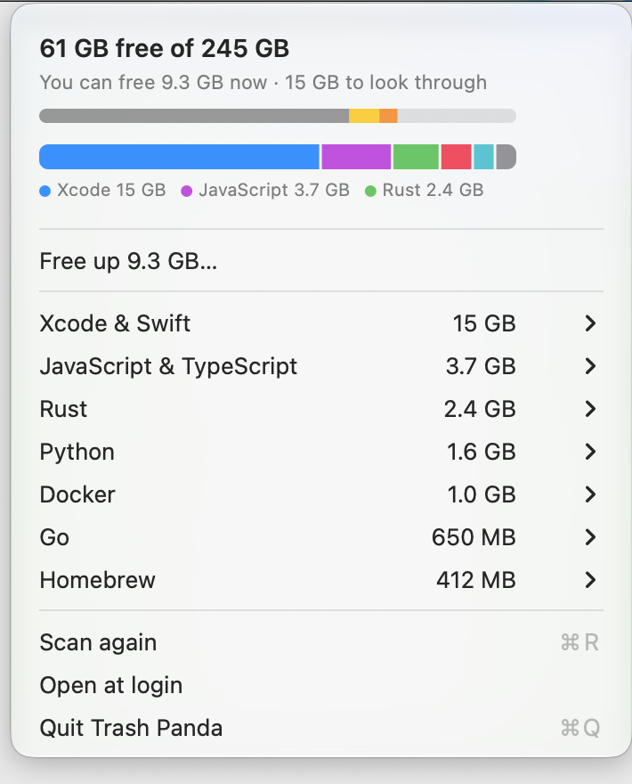
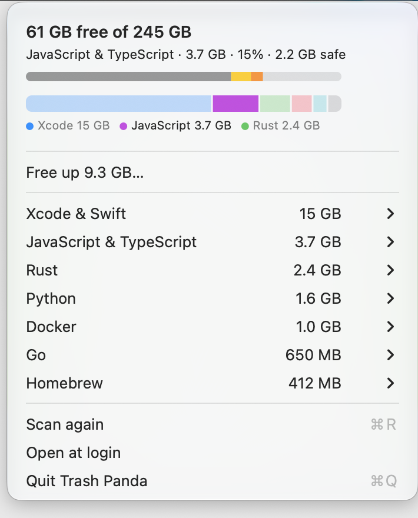

<p align="center"></p>

# Trash Panda

Trash Panda is a small menu bar app for developers. It finds the files that fill your disk. It shows how much space you can get back. You decide what to delete.

The app has no window. It has only a menu.

## What you see

<p align="center">
  <picture>
    <source media="(prefers-color-scheme: dark)" srcset="assets/menu-dark.png">
    
  </picture>
</p>

The picture uses made-up data.

Click the panda in the menu bar. The menu shows:

- The free space and the total space of your disk.
- A bar that shows where the data that you can clean is. Its whole width is that data. It is split by language or tool, and a short legend names the largest three.
- The space that you can reclaim now.
- One line for each language or tool. Open a line to see each item.

**Hover** a part of the bar to see its name, its size, its share, and how much of it is safe. **Click** a part to open the items of that language or tool. An item of an app that is open, and a line that is for information only, are not in the bar.

<p align="center">
  
</p>

## What it cleans

Trash Panda looks in two places:

1. **Global caches** in your home folder, for example the npm cache or Xcode build data.
2. **Build folders inside your projects**, for example `node_modules` or `target`.

| Language or tool | Global caches | Project folders |
| --- | --- | --- |
| Swift, Obj-C, Xcode | Build data, simulator caches, Swift packages, CocoaPods. Review: simulator runtimes, old simulators, archives, device support files (one item for each OS version; the newest of each device model is kept). | `.build`, `Pods` |
| JavaScript, TypeScript | npm, Yarn, Bun, pnpm, Playwright (old browser versions), Electron and node-gyp downloads | `node_modules`, `.next`, `.nuxt`, `.turbo` |
| Python | pip, uv, pre-commit, Poetry, Hugging Face, PyTorch | `.venv`, `.tox`, `.nox` |
| Java, Kotlin | Gradle, Maven, Android, Kotlin/Native, JetBrains | `target`, `build`, `.gradle` |
| C#, .NET | NuGet | `obj`, `bin`, `.vs` |
| C, C++ | ccache, clangd, vcpkg, Conan | CMake and Meson build folders |
| Go | Build cache, module cache | None |
| Rust | Cargo registry and git files | `target` |
| PHP | Composer | `vendor` |
| Ruby | Bundler | None |
| Dart, Flutter | Pub packages, analysis cache | `.dart_tool`, Flutter `build` |
| Elixir, Erlang | Hex packages, rebar3 | `_build`, `deps`, `.elixir_ls` |
| Zig | Global cache | `.zig-cache`, `zig-out` |
| Scala | Coursier cache (safe). Ivy cache (review). | `target` (sbt), `.bloop`, `.bsp`, `.metals`, `out` (Mill) |
| Haskell | Cabal and GHCup downloads (safe). Stack snapshots (review). | `dist-newstyle`, `.stack-work` |
| R | renv package cache (review). | None |
| Julia | Precompiled code (safe). Packages and artifacts (review). | None |
| Nim | Build cache (safe). | `nimcache` |
| Homebrew | Downloads and old versions (safe). Review: each package that no other package needs (`brew leaves`), with its install date. Brew removes it. | None |
| Browsers | Chromium browsers (Chrome, Arc, Brave, Edge, Vivaldi, Opera, Dia): cache, code cache, and GPU caches. Firefox and Zen: `cache2` and `startupCache`. Dia and Zen are not checked on a real install yet. Review: Service Worker storage. | None |
| Other apps | Old update downloads of apps that use the Sparkle updater (older than 7 days) | None |
| Logs and crash reports | Old files in `~/Library/Logs`: one review item for logs, one for crash reports (`DiagnosticReports`, `CrashReporter`). Files at least 30 days old only. | None |
| Old installers | `.dmg` and `.pkg` files in `~/Downloads` that are older than 30 days. One review item for each file. No other file type. | None |
| Trash | The size of `~/.Trash`. One review item. Finder empties it (see Safety rules). | None |
| Docker | Build cache, untagged images (safe). Stopped containers, old unused images, and unused volumes (review). | None |

Trash Panda does **not** touch your documents or app data. It removes a Docker image only when no container uses it, running or stopped. An old named image is a review item.

## Safe and Review

Each item has a tier.

- **Safe.** The item is cheap to get back. The "Reclaim" button deletes only safe items.
- **Review.** The item is costly to get back, or someone changed the project in the last 30 days (you can change the limit). You must choose each review item.

The menu shows the cost to get an item back. The cost is seconds, minutes, or a new download.

## Safety rules

Trash Panda deletes files for good. They do not go to the Trash. These rules reduce the risk:

- A Homebrew package is a review item, one for each package that no other package needs. Trash Panda does not delete its files: it runs `brew uninstall --formula <name>`, and never `--force` or `--ignore-dependencies`, so brew itself refuses when another package needs it. The app reads the list again when you confirm, and it skips a package that runs. Brew does not record when a tool was last used, so the menu shows the install date and never says "unused".
- Old logs and crash reports are two review items, never in the one-click clean, and the default button of the dialog keeps the files. Only plain files at least 30 days old count. A folder, a link, and a newer file never count, and the app reads the age again when you confirm. The log of Trash Panda (`~/Library/Logs/TrashPanda`) is never touched.
- Old installers are review items, one for each file, never in the one-click clean, and the default button of the dialog keeps the file. Only `.dmg` and `.pkg` files that lie directly in `~/Downloads` count, and only when they are at least 30 days old. A link, a folder, and a file in a sub-folder never count. The app reads the age again when you confirm, and it skips a disk image that is mounted. The first time, macOS asks if Trash Panda may look in Downloads. Say no, and the app shows no installers.
- The Trash is a review item. It is never in the one-click clean. Trash Panda does not delete those files itself: it asks Finder to empty the Trash, the same as the Finder menu. The first time, macOS asks if Trash Panda may control Finder. Say no, and nothing is deleted. The app reads only `~/.Trash`, not the Trash of an external drive. If macOS does not let the app read the Trash (Full Disk Access), the app shows nothing for it.
- The app always shows a list and asks you before it deletes.
- A project folder counts only when a marker file is next to it. For example, `node_modules` needs `package.json`.
- The app skips a project when a running process uses it.
- For a browser, the app removes only eight named cache folders inside each profile (`Default` or `Profile N`). It never touches cookies, logins, history, local storage, IndexedDB, extensions, preferences, sessions, or Service Worker storage. Service Worker storage (the files of websites that work offline) is its own review item. It is never in the one-click clean, and the default button of its dialog keeps it. Firefox gets two folders (`cache2` and `startupCache`) in `Library/Caches`, and its profile folder is never touched. Safari is not cleaned: macOS protects its folders with a Full Disk Access prompt, and the app never asks for it. A browser that is open is skipped. The item of an open app is listed like any other, with the icon of the app. Click it to see "Quit <app> and free <size>": Trash Panda asks the app to quit, the same as choosing Quit in the app, and waits. It never forces an app to quit, and an app that stays open is left alone.
- The app removes an update download only when it is older than 7 days, and it reads the age again when you confirm. It touches only the `Installation` and `PersistentDownloads` folders of an app, never the rest of its cache. It refuses a cache folder that is a link.
- The app does not clean a cache while the app that uses it runs. For example, Xcode build data waits until you quit Xcode. The menu shows which app to quit, and the cleaner checks again before each item.
- The app marks a project as review when someone changed it in the last 30 days. You can change this limit (see Settings).
- Python virtual environments are always review items.
- The app never follows symbolic links.
- The app never deletes outside your home folder.
- The app never deletes Documents, Desktop, Pictures, Movies, Music, `.ssh`, `.config`, iCloud, or app data.
- The app counts only space that a delete frees. A file with more than one hard link frees no space.
- For Homebrew, the app asks `brew` what it would remove. Homebrew keeps its own index files, and the app does not count them.
- The app asks the owning tool to clean its own data when it can. It runs fixed commands only.
- Xcode deletes a simulator runtime by shutting down the simulators on it, so the app refuses a runtime that has a running simulator. It keeps the newest runtime of each platform and any runtime used in the last 30 days. It never deletes a running simulator. It never uses the bulk forms of the simulator delete commands.
- An Xcode archive holds the symbol files that you need to read crash reports of a build that you shipped. The app lists each archive by itself, never in the one-click clean, and the default button of its dialog keeps it.
- Docker volumes can hold databases. The app removes a volume only when no container uses it and it is a local volume. Each volume needs its own confirmation, and the default button keeps it. A volume in use is shown but cannot be removed.
- Docker Desktop keeps all its data in one disk image file. The app shows the size that the file really uses, next to the size of the data inside. It never changes the file. Lowering the disk limit in Docker Desktop deletes the file and all containers and images, so the app never suggests it.
- The app never prunes all Docker images. It removes a named image only by its exact name, never forced.
- Docker runs on a local engine only (OrbStack, Docker Desktop, Colima, or Rancher Desktop). The app refuses remote engines and unknown sockets. It ignores `DOCKER_HOST` and `DOCKER_CONTEXT`.

## Install

You need macOS 13 or later.

### Option 1: DMG

1. Download the DMG from the [Releases page](https://github.com/chaitanya-ramji/trashpanda/releases). The newest build is the **0.4.0 beta** (a pre-release). It has more safety checks than 0.1.0, which can act on a remote Docker engine and can clean Xcode data while Xcode runs. The beta also has more features, and some of them are not tested yet on many real Macs. Its release notes list them.
2. Open the DMG. Drag Trash Panda to Applications.
3. Open Trash Panda from Applications.

The app is not notarized by Apple yet. macOS blocks the first launch. To allow it, use one of these methods:

- Open **System Settings**, then **Privacy & Security**. Scroll down and click **Open Anyway** next to Trash Panda.
- Or run this command in Terminal, then open the app again:

```sh
xattr -dr com.apple.quarantine /Applications/TrashPanda.app
```

You do this one time only. To check the download, compare its SHA-256 checksum with the `.sha256` file on the Releases page.

### Option 2: Build from source

An app that you build on your own Mac does not need approval. You need the Swift toolchain (Xcode or the Command Line Tools).

```sh
git clone https://github.com/chaitanya-ramji/trashpanda.git
cd trashpanda
./scripts/install-from-source.sh
```

The script builds the app, copies it to Applications, and opens it.

To build without installing:

```sh
./scripts/build-app.sh
open build/TrashPanda.app
```

### Homebrew

A Homebrew cask is planned. It needs a notarized app first.

To start the app at login, choose **Open at Login** in the menu.

To see the result without the menu, run this command. It never deletes anything.

```sh
.build/release/trashpanda --scan
```

## Spinner and log

The panda in the menu bar turns into a spinner while the app scans or cleans. The menu header shows a spinner too.

The app writes every scan, every command, and every delete to a log:

```
~/Library/Logs/TrashPanda/trashpanda.log
```

Hold the Option key and open the menu. Choose **Show log in Finder**. The log shows the size of each item before and after a clean. After each clean, the app measures what is left. The "Freed" number is the measured result.

## Settings

Settings are plain text files. Each file has one path on each line. A line that starts with `#` is a comment.

- `~/.config/trashpanda/keep` lists paths that the app never touches.
- `~/.config/trashpanda/roots` lists more folders to search for projects.
- `~/.config/trashpanda/settings` holds options as `name = value` lines.

The `settings` file has one option now:

```
# A project that changed within this many days is a review item.
# A Docker image is listed only when it has been on this Mac for this many days.
# Use a whole number from 1 to 3650.
stale_days = 30
```

If the value is not valid, the app uses 30 and writes a warning to the log.

The app searches these folders by default: `Developer`, `dev`, `Projects`, `Code`, `GitHub`, `Repos`, `Workspace`, `Development`, `src`, `work`, and `www`.

## Development

```sh
swift build
swift test
```

The code has two parts:

- `PandaCore` finds items and deletes them. It has all the safety rules and the tests.
- `TrashPanda` is the menu bar app. It has no logic that deletes files.

To add a language, add rows to `Sources/PandaCore/Catalog.swift`. Add a test in `Tests/PandaCoreTests`.

## Roadmap

We work from the pinned [Roadmap issue](https://github.com/chaitanya-ramji/trashpanda/issues/38). Each box below is an issue. Pick one and help.

### Done
- [x] Menu bar app with a storage bar and the reclaimable total
- [x] Ten language groups: Swift and Xcode, JavaScript and TypeScript, Python, Java and Kotlin, C# and .NET, C and C++, Go, Rust, PHP, Ruby
- [x] Homebrew and Docker build cache
- [x] Safe and review tiers, path guard, and a log
- [x] Spinner, new icon, and a DMG release (not notarized)

### Now: v0.2 Dart, Elixir, Zig
- [x] Add Dart and Flutter support ([#1](https://github.com/chaitanya-ramji/trashpanda/issues/1))
- [x] Add Elixir and Erlang support ([#2](https://github.com/chaitanya-ramji/trashpanda/issues/2))
- [x] Add Zig support ([#3](https://github.com/chaitanya-ramji/trashpanda/issues/3))
- [x] Let the user set the stale limit ([#4](https://github.com/chaitanya-ramji/trashpanda/issues/4))
- [x] Add a screenshot of the menu to the README ([#5](https://github.com/chaitanya-ramji/trashpanda/issues/5))

### Next: v0.3 Docker
- [x] Docker: act only on a local engine ([#6](https://github.com/chaitanya-ramji/trashpanda/issues/6))
- [x] Docker: remove dangling images ([#7](https://github.com/chaitanya-ramji/trashpanda/issues/7))
- [x] Docker: remove stopped containers ([#8](https://github.com/chaitanya-ramji/trashpanda/issues/8))
- [x] Docker: remove unused images older than N days ([#9](https://github.com/chaitanya-ramji/trashpanda/issues/9))
- [x] Docker: show volumes and remove dangling ones ([#10](https://github.com/chaitanya-ramji/trashpanda/issues/10))
- [x] Docker: test with a fake docker tool ([#11](https://github.com/chaitanya-ramji/trashpanda/issues/11))
- [x] Docker: explain a VM disk that does not shrink ([#12](https://github.com/chaitanya-ramji/trashpanda/issues/12))
- [x] Roadmap: keep the checkboxes correct ([#39](https://github.com/chaitanya-ramji/trashpanda/issues/39))

### Next: v0.4 Xcode, app and browser caches
- [x] Xcode: old simulator runtimes, devices, and archives (review) ([#27](https://github.com/chaitanya-ramji/trashpanda/issues/27))
- [x] Xcode: iOS device support files, one item for each iOS version ([#41](https://github.com/chaitanya-ramji/trashpanda/issues/41))
- [ ] Xcode: keep the device support folder of a connected device ([#43](https://github.com/chaitanya-ramji/trashpanda/issues/43))
- [x] Menu header: one bar, aligned to the menu edge ([#45](https://github.com/chaitanya-ramji/trashpanda/issues/45))
- [x] Browsers: Dia, Zen, and Safari ([#46](https://github.com/chaitanya-ramji/trashpanda/issues/46))
- [x] Blocked app: offer Quit and clean ([#47](https://github.com/chaitanya-ramji/trashpanda/issues/47))
- [x] Open-app items: list them like any item, with the app icon ([#48](https://github.com/chaitanya-ramji/trashpanda/issues/48))
- [x] Clean stale app update downloads ([#13](https://github.com/chaitanya-ramji/trashpanda/issues/13))
- [x] Browser caches: Chromium browsers ([#14](https://github.com/chaitanya-ramji/trashpanda/issues/14))
- [x] Browser caches: Firefox ([#15](https://github.com/chaitanya-ramji/trashpanda/issues/15))
- [x] Do not clean an app while it runs ([#16](https://github.com/chaitanya-ramji/trashpanda/issues/16))
- [x] Browser Service Worker storage (review only) ([#17](https://github.com/chaitanya-ramji/trashpanda/issues/17))
- [x] Old test browser downloads: Cypress, Playwright, Puppeteer, Chrome for Testing ([#18](https://github.com/chaitanya-ramji/trashpanda/issues/18))
- [x] Electron and node-gyp download caches ([#19](https://github.com/chaitanya-ramji/trashpanda/issues/19))

### Later: v0.5 Insight
- [ ] Cache explorer: show the largest folders in Library/Caches ([#20](https://github.com/chaitanya-ramji/trashpanda/issues/20))
- [ ] Explain space that does not come back: local snapshots ([#21](https://github.com/chaitanya-ramji/trashpanda/issues/21))
- [x] Logs and crash reports (review) ([#22](https://github.com/chaitanya-ramji/trashpanda/issues/22))
- [x] Show the Trash size and offer to empty it ([#23](https://github.com/chaitanya-ramji/trashpanda/issues/23))
- [x] Old installers in Downloads (DMG, PKG, ZIP) ([#24](https://github.com/chaitanya-ramji/trashpanda/issues/24))
- [ ] Docker: say when freed space is not back on the Mac yet ([#40](https://github.com/chaitanya-ramji/trashpanda/issues/40))
- [ ] Service Worker storage: show each website by name ([#44](https://github.com/chaitanya-ramji/trashpanda/issues/44))
- [x] Menu: show the full split of reclaimable data as an interactive bar ([#42](https://github.com/chaitanya-ramji/trashpanda/issues/42))

### Later: v0.6 Old tools
- [ ] Old language runtimes: nvm, fnm, pyenv, rustup, sdkman, mise, asdf ([#25](https://github.com/chaitanya-ramji/trashpanda/issues/25))
- [x] Unused Homebrew packages ([#26](https://github.com/chaitanya-ramji/trashpanda/issues/26))
- [ ] Unused global JavaScript packages: npm, pnpm, Bun, Yarn ([#51](https://github.com/chaitanya-ramji/trashpanda/issues/51))
- [ ] AI coding tool caches and old versions ([#28](https://github.com/chaitanya-ramji/trashpanda/issues/28))
- [ ] More languages (phase 2b): Scala, Haskell, R, Julia, Nim, OCaml, Crystal, Clojure, Perl, Lua ([#29](https://github.com/chaitanya-ramji/trashpanda/issues/29))

### Later: v1.0 Signed and stable
- [ ] Notarize the app and publish signed releases ([#30](https://github.com/chaitanya-ramji/trashpanda/issues/30))
- [ ] Homebrew cask and tap ([#31](https://github.com/chaitanya-ramji/trashpanda/issues/31))
- [ ] Check for updates ([#32](https://github.com/chaitanya-ramji/trashpanda/issues/32))
- [ ] Move to Trash delete mode ([#33](https://github.com/chaitanya-ramji/trashpanda/issues/33))
- [ ] Low-disk alert ([#34](https://github.com/chaitanya-ramji/trashpanda/issues/34))
- [ ] Scheduled clean (opt in) ([#35](https://github.com/chaitanya-ramji/trashpanda/issues/35))
- [ ] Test on Intel Macs and older macOS versions ([#36](https://github.com/chaitanya-ramji/trashpanda/issues/36))
- [ ] Decide: cloud-synced project folders ([#37](https://github.com/chaitanya-ramji/trashpanda/issues/37))

## Licence

Trash Panda is free software under the GNU General Public License, version 3. See `LICENSE`. Credits are in `NOTICE`.
